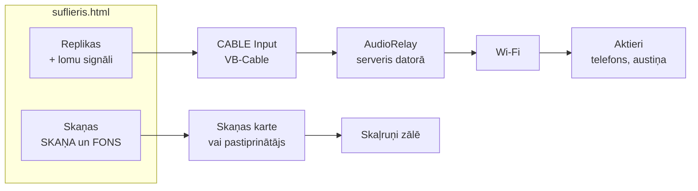

# Suflieris — lietotāja instrukcija

[← Atpakaļ uz projekta aprakstu](README.md)

## Saturs

1. [Kam domāta programma](#kam-domāta-programma)
2. [Kas vajadzīgs](#kas-vajadzīgs)
3. [Darba gaita īsumā](#darba-gaita-īsumā)
4. [Audio faila sagatavošana](#audio-faila-sagatavošana)
5. [SRT faila formāts](#srt-faila-formāts)
6. [SRT izveide ar Subtitle Edit](#srt-izveide-ar-subtitle-edit)
7. [Programmas ekrāns un vadība](#programmas-ekrāns-un-vadība)
8. [Saturs un lugas saīsināšana](#saturs-un-lugas-saīsināšana)
9. [Lomu signāli un iestatījumi](#lomu-signāli-un-iestatījumi)
10. [Skaņas maršrutēšana](#skaņas-maršrutēšana)
11. [Praktiski padomi un problēmu risināšana](#praktiski-padomi-un-problēmu-risināšana)

## Kam domāta programma

Suflieris ir sufliera un skaņotāja pults teātra kolektīvam. Tā darbojas pārlūkā uz viena datora un vada divas lietas: aktieru suflēšanu austiņās un skaņas efektus zālē.

**Suflēšana.** Katram aktierim ir telefons ar AudioRelay lietotni un maza austiņa. Suflieris pie datora seko izrādei. Īstajā brīdī viņš nospiež vienu taustiņu, un aktieris austiņā dzird nākamo repliku. Pirms replikas atskan īss lomas signāls, tāpēc aktieris uzreiz zina, ka frāze ir viņam.

**Skaņotājs.** Tajā pašā lugas tekstā ir iezīmētas skaņas: īsi efekti tieši darbības vietā un fona skaņas atsevišķā stabiņā. Tās skan zāles skaļruņos, nevis aktieru austiņās.

Visa luga ir divi faili: **viens audio fails** ar ierakstītu tekstu un skaņām un **viens SRT subtitru fails**, kurā iezīmēts, kur katra replika vai skaņa sākas un beidzas.

Programma ir viens fails `suflieris.html`. Tas nav jāinstalē, un tas darbojas bez interneta.

## Kas vajadzīgs

| Kas | Kam tas vajadzīgs | Piezīmes |
| --- | --- | --- |
| Dators ar Windows | Programmas darbināšanai | Ieteicams vismaz 8 GB RAM, ja luga ir garāka par stundu |
| Chrome vai Edge | Programmas atvēršanai | Tikai tie ļauj izvēlēties izvades ierīci un saglabāt failu programmā |
| `suflieris.html` | Pati programma | Atver ar dubultklikšķi, darbojas bez interneta |
| AudioRelay (dators + telefoni) | Sufliera skaņas pārraidei pa Wi-Fi | Serveris datorā, lietotne katrā telefonā |
| VB-Audio Virtual Cable | Sufliera un zāles skaņas atdalīšanai | Bezmaksas, rada ierīci „CABLE Input” |
| Wi-Fi maršrutētājs | Savienojumam starp datoru un telefoniem | Ieteicams atsevišķs, nevis zāles publiskais tīkls |
| Telefoni un austiņas | Aktieriem | Mazas austiņas ar vadu; Bluetooth pieliek aizkavi |
| Subtitle Edit | SRT faila izveidei | Bezmaksas, Windows; ir iebūvēta runas atpazīšana |
| Skaņas karte vai pastiprinātājs | Zāles skaļruņiem | Var būt arī datora parastā skaņas izeja |

## Darba gaita īsumā

No lugas eksemplāra līdz izrādei ir septiņi soļi. Lielākais darbs ir 2. un 3. solis; pārējais aizņem dažas minūtes.

1. **Ierakstiet audio.** Vienā failā vispirms viss lugas teksts, aiz tā visas vajadzīgās skaņas.
2. **Izveidojiet SRT.** Atveriet ierakstu Subtitle Edit, ļaujiet runas atpazīšanai izveidot subtitrus ar laikiem.
3. **Pielabojiet SRT.** Robežas pa frāzēm, lomu vārdi `VĀRDS:` priekšā, skaņām `SKAŅA:` vai `FONS:`, virsraksti ar `#`.
4. **Atveriet `suflieris.html`** Chrome vai Edge un ielādējiet audio un SRT ar pogām augšā.
5. **Pārbaudiet lomu signālus** un, ja vajag, nomainiet tos cilnē Lomas.
6. **Iestatiet izvades:** suflieris uz CABLE Input (AudioRelay), skaņas uz zāles skaļruņiem.
7. **Mēģinājumā** izejiet cauri visai lugai un pielabojiet nobīdi vai rezerves, ja frāzes tiek nogrieztas.

## Audio faila sagatavošana

Visai lugai pietiek ar vienu audio failu. Programma to ielādē atmiņā vienu reizi un var vienlaikus atskaņot vairākus tā fragmentus: repliku suflierim, īsu efektu un fona skaņu.

**Teksta ierakstīšana**

- Lasiet tikai replikas, **bez lomu vārdiem**. Lomu programma uzzina no SRT faila.
- Starp replikām atstājiet **apmēram 1 sekundes pauzi**. Tad runas atpazīšana un robežu iezīmēšana ir daudz precīzāka.
- Kļūdas gadījumā vienkārši pasakiet frāzi vēlreiz. Lieko vēlāk izlaiž SRT failā.
- Lasiet skaidri un vienmērīgā tempā. Ātrumu var palielināt programmā līdz 3×, bet lēnāk par ierakstu atskaņot nevar.

**Skaņu ievietošana**

- **Ieteicamais veids: visas skaņas faila beigās.** Audio faila sākumā ir tikai teksts, bet pēc pēdējās replikas visas skaņas pēc kārtas. Tā audio failu ir daudz vieglāk sagatavot.
- Kā skaņas sasaista ar vietām tekstā, aprakstīts sadaļā [Skaņu bloks faila beigās](#skaņu-bloks-faila-beigās).
- Joprojām var arī ievietot skaņu audio failā tieši tajā vietā, kur tā notiek lugā. Abus veidus var jaukt.
- Skaņu un teksta apvienošanai der jebkurš audio redaktors, piemēram, bezmaksas [Audacity](https://www.audacityteam.org).

**Formāts un apjoms**

- Der MP3, WAV, M4A, OGG. Programma failu pati atkodē, tāpēc MP3 laiku nobīdes nerodas.
- Programma izvēlas kvalitāti pēc faila lieluma: līdz 60 MB pilnā kvalitātē (44,1 kHz), līdz 150 MB 32 kHz, lielākiem 24 kHz. Runai un efektiem tas ir pietiekami.
- Garai lugai ielāde aizņem dažas sekundes. Lugai, kas garāka par 2 stundām, ieteicams dators ar 8 GB vai vairāk RAM.

## SRT faila formāts

SRT failā katrs bloks ir viena replika, remarka, skaņa vai virsraksts. Bloks sastāv no kārtas numura, laika rindas un teksta, un aiz tā ir tukša rinda. Laiks norāda, no kuras līdz kurai vietai audio failā tas skan.

```
12
00:03:41,200 --> 00:03:44,850
HAMLETS: Būt vai nebūt — tas ir jautājums.
```

Laika formāts ir `stundas:minūtes:sekundes,milisekundes`. Programma ieraksta veidu atpazīst pēc teksta sākuma:

| Teksts SRT blokā | Ko programma dara | Kur redzams |
| --- | --- | --- |
| `MARTA: Vilciens kavējas…` | Replika; pirms tās atskan Martas signāls | Tekstā, lomas krāsā |
| `Tagad vairs nepārdodu.` (bez vārda) | Tās pašas lomas turpinājums, atzīmēts ↳ | Tekstā; signāls pēc izvēles |
| `MARTA, ERNESTS: Vilciens!` | Kopīga replika, savs atsevišķs signāls | Tekstā |
| `(Marta iziet.)` | Remarka; netiek atskaņota | Tekstā, slīprakstā |
| `SKAŅA: Durvju klauvējiens` | Īsa skaņa zālei (der arī `EFEKTS:`) | Tekstā, pa labi, zaļā rāmī |
| `FONS: Vējš stacijā` | Fona skaņa zālei (der arī `ATMOSFĒRA:`) | Atmosfēras stabiņā + maza atzīme tekstā |
| `FONS: Vējš stacijā (cilpa)` | Fons, kas atkārtojas līdz apturēšanai | Atmosfēras stabiņā ar zīmi „cilpa” |
| `# 1. CĒLIENS`, `## 2. aina` | Virsraksts saturam; netiek atskaņots | Tekstā un stabiņā Saturs |
| `[IZSLĒGTS] MARTA: …` | Izslēgts bloks; programma to izlaiž | Tekstā, pelēks un pārsvītrots |

**Lomu vārdi**

- Vārdu raksta **ar lielajiem burtiem** un kolu: `OFĒLIJA:`. Tā programma to neatšķir no parasta teikuma ar kolu.
- Vārdam jābūt uzrakstītam **vienādi visā lugā**. `MARTA` un `Marta` ir viena loma, bet `MARTA` un `MĀRTA` ir divas.
- Programma lomas un to signālus izveido pati. Lomu skaitam nav ierobežojuma.

**Skaņas**

- Atslēgvārdi `SKAŅA`, `EFEKTS`, `FONS`, `ATMOSFĒRA` var būt ar lieliem vai maziem burtiem. Šie vārdi nekad netiek uzskatīti par lomām.
- Nosaukums aiz kola parādās ekrānā. Tajā var būt koli un iekavas.
- Skaņas ilgumu nosaka bloka laiks. Garu mūziku iezīmē ar garu intervālu.

**Secība un pārbaude**

- **Secība SRT failā ir izrādes secība.** Tā nosaka, kā ieraksti redzami ekrānā un kurā secībā tos piedāvā Enter.
- Beigu laikam jābūt lielākam par sākuma laiku, citādi bloks tiek izlaists.
- Saglabājiet failu kā **UTF-8**, lai garumzīmes un mīkstinājuma zīmes rādītos pareizi.
- Ja SRT beidzas vēlāk nekā audio, programma par to brīdina.

### Skaņu bloks faila beigās

Skaņām nav jāatrodas audio failā starp replikām. Tās var salikt pēc pēdējās replikas, un SRT failā tekstā atstāj tikai norādi, kurā vietā skaņa notiek.

1. **Tekstā**, starp replikām, ierakstiet skaņas bloku, piemēram `SKAŅA: Tāla vilciena svilpe`. Tā laiks var būt jebkāds īss intervāls, piemēram 0,3 s pauzē starp replikām. Šo laiku programma neizmanto.
2. **Faila beigās**, aiz pēdējās replikas, ierakstiet bloku **ar tādu pašu nosaukumu** un īstajiem laikiem, kur skaņa ir audio failā.
3. Programma skaņai tekstā ņem audio no bloka beigās. Bloks beigās ekrānā netiek rādīts. Tekstā pie skaņas ilguma ir zīme **↧**.

```
15
00:00:37,391 --> 00:00:37,691
SKAŅA: Tāla vilciena svilpe

…

23
00:01:55,989 --> 00:01:59,529
SKAŅA: Tāla vilciena svilpe
```

- Nosaukumam jāsakrīt; lielie un mazie burti un `(cilpa)` nav svarīgi. Vai tā ir `SKAŅA` vai `FONS` un vai tā ir cilpa, nosaka bloks **tekstā**.
- Vienu skaņu var lietot tekstā vairākas reizes. Visas norādes ņems audio no viena bloka beigās.
- Ja skaņai tekstā beigās nav bloka ar tādu nosaukumu, tā skan no saviem laikiem.
- Skaņa, kas notiek pēc pēdējās replikas (piemēram, fināla mūzika), arī var būt ar norādi un bloku beigās.
- Pēc ielādes programma paziņo, cik skaņu ņemts no bloka beigās. Ja skaitlis ir mazāks nekā gaidīts, pārbaudiet nosaukumu rakstību.

### Virsraksti saturam

Cēlieni, ainas un skati ir SRT bloki, kuru teksts sākas ar `#`. Restīšu skaits nosaka līmeni, un nosaukums var būt jebkāds, kā to nosaucis autors.

```
1
00:00:00,000 --> 00:00:00,300
# 1. CĒLIENS

2
00:00:00,300 --> 00:00:00,600
## 1. aina. Stacija vakarā
```

- `#` ir augstākais līmenis (cēliens, daļa), `##` otrais (aina, nodaļa), `###` trešais (skats, parādība).
- Virsraksta laiks var būt jebkāds īss intervāls pirms sadaļas pirmās replikas. Programma to neatskaņo.
- Atslēgvārdus bez `#` (piemēram, `AINA:`) programma par virsrakstu neuzskata, jo tādi vārdi var būt arī lomu vārdi.

### Izslēgti bloki

Bloks, kura teksts sākas ar `[IZSLĒGTS]`, ir izslēgts: tas redzams pelēks un pārsvītrots, un programma to izlaiž. Šo atzīmi parasti nav jāraksta ar roku, jo programma to ieliek pati, saglabājot SRT.

```
9
00:00:21,560 --> 00:00:24,520
[IZSLĒGTS] Tagad vairs nepārdodu. Tagad tikai gaidu.
```

Pilns piemērs ir failā [`paraugs/luga_paraugs.srt`](paraugs/luga_paraugs.srt), kas atbilst audio failam [`paraugs/luga_paraugs.mp3`](paraugs/luga_paraugs.mp3?raw=true). Ar šo paraugu programma arī atveras pirmo reizi.

## SRT izveide ar Subtitle Edit

Ieteicamā programma SRT izveidei ir **[Subtitle Edit](https://www.nikse.dk/subtitleedit)**: bezmaksas, Windows, ar skaņas viļņa attēlu un iebūvētu runas atpazīšanu *Whisper*, kas saprot latviešu valodu. Vienai lugai labošana parasti aizņem stundu vai divas.

**Automātiska izveide**

1. Atveriet audio failu Subtitle Edit (*Video → Open video file*; der arī tikai audio).
2. Palaidiet runas atpazīšanu (*Video → Audio to text (Whisper)*), valoda latviešu. Ieteicams lielākais modelis, ko dators spēj darbināt.
3. Rezultātā ir subtitri ar laikiem visam ierakstam.

**Labošana**

- **Robežas pa frāzēm.** Whisper dala runu pēc savas loģikas, nevis pēc replikām. Apvienojiet blokus, kas pieder vienai replikai, un sadaliet tos, kas satur divas.
- **Robežu precizēšana.** Skaņas viļņa attēlā bloka sākumu un beigas var pavilkt ar peli. Atstājiet sākumā un beigās nelielu rezervi, lai pirmā vai pēdējā zilbe netiktu nogriezta.
- **Teksts.** Atpazītajā tekstā būs kļūdas. Ja lugas teksts ir elektroniski, labāk iekopēt pareizo tekstu no eksemplāra.
- **Lomu vārdi.** Katram blokam priekšā ierakstiet `VĀRDS:`. Turpinājumiem tajā pašā replikā vārdu var nerakstīt.
- **Skaņas un virsraksti.** Izveidojiet blokus ar `SKAŅA:`, `FONS:` vai `#` un iezīmējiet skaņu robežas viļņa attēlā.

**Ja Whisper nestrādā labi**, var izmantot manuālo režīmu: klausoties ierakstu, nospiež taustiņu frāzes sākumā un beigās, un Subtitle Edit pats izveido laikus.

**Saglabāšana:** *File → Save as*, formāts *SubRip (.srt)*, kodējums **UTF-8**. Ja programma brīdina par pārklājumiem vai nesakārtotiem laikiem, tas ir normāli, ja skaņas speciāli ievietotas faila beigās.

## Programmas ekrāns un vadība

Ekrāns ir sadalīts stabiņos: **lugas teksts** vidū, pa labi **Saturs**, **Atmosfēra** un **Iestatījumi**. Saturu un iestatījumus paslēpj vai atver ar pogām augšā.

- **Lugas teksts.** Aktuālā replika vienmēr ir ekrāna vidū, iekrāsota un ar progresa joslu. Iepriekšējās replikas ir pelēkas. Īsās skaņas ir tekstā pa labi, zaļos rāmjos.
- **Atmosfēra.** Fona skaņas, poga „Apturēt visas skaņas” un skaņu skaļuma slīdnis.
- **Apakšējā josla.** Sufliera stāvoklis (GAIDA, SIGNĀLS, SKAN, PAUZE), aktuālā loma, replikas numurs, atlikušais laiks un nākamā skaņa, ko atskaņos Enter.

**Suflieris (tastatūra)**

| Taustiņš | Darbība |
| --- | --- |
| Space | Atskaņo lomas signālu un repliku. Atskaņošanas laikā: pauze. Pauzē: turpina līdz galam |
| ↑ | Pauzē: atgriež repliku uz sākumu. Citādi: iepriekšējā replika |
| ↓ | Nākamā replika |
| Esc vai Backspace (⌫) | Aptur un atgriež aktuālo repliku uz sākumu |
| Home / End | Uz lugas pirmo / pēdējo repliku |
| Klikšķis uz replikas | Izvēlas šo repliku |

Kad replika noskan līdz galam, programma pati pāriet uz nākamo un gaida. Bultiņas atskaņošanas laikā nedarbojas, lai nejauši nepārlēktu. Esc taustiņu dažreiz „noķer” pārlūks, tāpēc droši var lietot Backspace.

**Skaņas (tastatūra un pele)**

| Vadība | Darbība |
| --- | --- |
| Enter | Atskaņo nākamo iezīmēto skaņu (izcelta ar rāmi) |
| Delete | Aptur visas skaņas ar vienmērīgu izdzišanu |
| ▶ / ❚❚ | Atskaņo vai nopauzē šo skaņu; pēc pauzes turpina no tās pašas vietas |
| ⟲ | Aptur skaņu un atgriež to sākumā |

Nākamā skaņa seko suflierim: Enter vienmēr piedāvā pirmo vēl neatskaņoto skaņu pēc iepriekšējās replikas. Vairākas skaņas var skanēt vienlaikus, piemēram, fona mūzika un īss efekts.

## Saturs un lugas saīsināšana

Garā lugā pa ainām pārvietojas ar saturu, bet režisora saīsinājumus atzīmē ar ķeksīšiem pie blokiem un saglabā kā jaunu SRT versiju.

**Saturs.** Stabiņā **Saturs** redzami visi virsraksti ar aktīvo replikas skaitu katrā. Klikšķis uz virsraksta pārlec uz sadaļas pirmo ieslēgto repliku. Sadaļa, kurā atrodas suflieris, ir iezīmēta. Atskaņošanas laikā pārlēkt nevar: vispirms apturiet repliku.

**Bloku izslēgšana.** Katra bloka labajā pusē ir neuzkrītošs ķeksītis, kas ieslēgts pēc noklusējuma. Noņemot to:

- replika, remarka vai skaņa kļūst pelēka un pārsvītrota;
- Space, bultiņas, automātiskā pāreja uz nākamo repliku un Enter to izlaiž;
- replikas numurs apakšējā joslā skaita tikai ieslēgtās replikas;
- ķeksītis pie **virsraksta** ieslēdz vai izslēdz **visu sadaļu** līdz nākamajam tāda paša vai augstāka līmeņa virsrakstam.

Izslēgtu bloku jebkurā brīdī var atkal ieslēgt ar to pašu ķeksīti. Poga „Ieslēgt visus blokus” cilnē Iestatījumi atjauno pilnu lugu.

**Versijas saglabāšana.** Izmaiņas ķeksīšos ir jāsaglabā, citādi pēc lapas aizvēršanas tās zūd.

1. Kad ir nesaglabātas izmaiņas, poga **„Saglabāt SRT •”** augšā kļūst dzeltena ar punktu. Cilnē Iestatījumi, sadaļā „Lugas versija”, redzams izslēgto bloku skaits.
2. Nospiediet „Saglabāt SRT”. Chrome vai Edge piedāvā izvēlēties vietu un nosaukumu. Jaunu versiju ieteicams saglabāt ar citu nosaukumu, piemēram `luga_v2_saisinata.srt`, lai oriģināls paliek.
3. Saglabātajā failā izslēgtajiem blokiem priekšā ir `[IZSLĒGTS]`. Ielādējot to vēlreiz, tie paši bloki atkal ir izslēgti.

Ja saglabāt neizdodas, poga „Kopēt SRT tekstu” nokopē visu SRT, ko var ielīmēt teksta failā.

Saglabātais fails satur visus blokus, arī skaņu bloku faila beigās un virsrakstus. Laiki un teksts paliek nemainīti; mainās tikai bloku numerācija un `[IZSLĒGTS]` atzīmes. HTML formatējums, piemēram slīpraksts `<i>`, saglabājot tiek noņemts.

## Lomu signāli un iestatījumi

Katrai lomai programma automātiski piešķir krāsu un ~0,5 sekundes garu signālu: 2–3 nošu melodiju un tembru. Signālu programma sintezē pati, tas nav jāieraksta audio failā.

**Lomu signāli** (cilne Lomas)

- Ir 12 melodijas (piemēram, „Kvarta augšup”, „Trijskanis lejup”) un 5 tembri: zvans, ksilofons, flauta, ērģeles, pīkstiens.
- Lomas saņem signālus secībā, kādā tās pirmo reizi parādās lugā. Ja lomu ir vairāk par 12, melodijas atkārtojas ar citu tembri.
- Melodiju un tembru var nomainīt izvēlnēs; ▶ to noklausās. Izvēle saglabājas pārlūkā pēc lomas vārda, arī ielādējot labotu SRT.
- Signāls vienmēr skan normālā ātrumā, neatkarīgi no atskaņošanas ātruma.

**Iestatījumi**

| Iestatījums | Ko tas dara | Sākotnēji |
| --- | --- | --- |
| Ātrums (augšā) | Replikas ātrums 1×–3× bez balss toņa maiņas; neietekmē skaņas | 1× |
| Atskaņot lomas signālu | Ieslēdz vai izslēdz signālus | Ieslēgts |
| Signāls arī turpinājumam (↳) | Signāls arī replikām bez vārda | Izslēgts |
| Signāla skaļums | Signāla skaļums pret repliku | 60% |
| Laika nobīde | Pārbīda visus replikas laikus, ja SRT un audio ir nobīdīti | 0,00 s |
| Rezerve pirms | Cik agrāk sākt pirms bloka sākuma | 0,05 s |
| Rezerve pēc | Cik ilgāk skanēt pēc bloka beigām | 0,20 s |
| Skaņu skaļums (Atmosfēra) | Visu skaņu skaļums zālē | 100% |

Ja replikai tiek nogriezta pirmā vai pēdējā zilbe, palieliniet rezervi. Ja visas replikas sākas par agru vai par vēlu, mainiet laika nobīdi. Visi iestatījumi saglabājas pārlūkā.

**Suflēšanas izslēgšana lomai**

Ja aktieris tekstu zina no galvas vai lasa no lapas, cilnē Lomas noņemiet ķeksīti **„Suflēt šai lomai”** (pēc noklusējuma ieslēgts visām lomām). Šīs lomas replikas tekstā joprojām iekrāsojas un progresa josla iet līdzi, bet nav ne skaņas, ne lomas signāla. Tekstā un apakšējā joslā pie lomas ir sarkana atzīme **„bez skaņas”**.

**Divas aktieru grupas: kreisais un labais kanāls**

Katrai lomai cilnē Lomas var izvēlēties kanālu. Tad A grupa dzird tikai savas replikas kreisajā austiņā, bet B grupa labajā. SRT fails nav jāmaina.

| Kanāls | Kur skan replika un lomas signāls | Atzīme tekstā |
| --- | --- | --- |
| Abi | Abās austiņās, dzird visi | nav |
| Kreisais (A grupa) | Tikai kreisajā austiņā | ◀ kreisā |
| Labais (B grupa) | Tikai labajā austiņā | labā ▶ |

- Kopīgai replikai, piemēram `MARTA, ERNESTS:`, ir sava loma sarakstā. Ja lomas ir dažādās grupās, izvēlieties „Abi”.
- Aktierim vajag **parastas stereo austiņas**, no kurām viņš lieto vienu: A grupa kreiso (L), B grupa labo (R). Vienas auss austiņas bieži apvieno abus kanālus, un tad dalījums nedarbojas.
- AudioRelay lietotnē telefonā pārliecinieties, ka pārraide ir **stereo**, nevis mono.
- Pirms izrādes katrs aktieris pārbauda savu ausi ar pogām „Pārbaudīt kanālu: ◀ Kreisais · Abi · Labais ▶” cilnē Iestatījumi.

## Skaņas maršrutēšana

Suflierim un zālei ir divi atsevišķi skaņas ceļi. Replikas un lomu signāli caur virtuālo kabeli un AudioRelay nonāk tikai aktieru austiņās, bet skaņas efekti un fons skan tikai zāles skaļruņos.



**Vienreizēja uzstādīšana**

1. Uzstādiet **[VB-Audio Virtual Cable](https://vb-audio.com/Cable/)**. Datorā parādās ierīces „CABLE Input” un „CABLE Output”.
2. **AudioRelay serverī** datorā kā skaņas avotu izvēlieties **CABLE Output**. AudioRelay pats neseko Windows noklusētajai ierīcei, tāpēc avots jāizvēlas ar roku.
3. **Suflierī** atveriet Iestatījumus un nospiediet **„Nolasīt ierīču sarakstu”**. Pārlūks vienreiz lūgs atļauju, lai parādītu ierīču nosaukumus.
4. Izvēlieties **Suflieris → CABLE Input** un **Skaņas → zāles skaļruņi** (skaņas karte vai datora izeja).

Izvēle saglabājas pēc ierīces nosaukuma, un nākamreiz ieslēdzas automātiski. Ierīču izvēle strādā Chrome un Edge.

**Ja ierīču izvēle programmā nav pieejama**, izvadi var iestatīt Windows: *Iestatījumi → Sistēma → Skaņa → Skaļuma mikseris*, pārlūkam izvēloties „CABLE Input”. Tad gan suflieris, gan skaņas nonāks AudioRelay, tāpēc šis ceļš der tikai bez zāles skaņām.

## Praktiski padomi un problēmu risināšana

**Pirms izrādes**

- Izrādē atveriet lokāli saglabātu `suflieris.html` failu. Tad programma nav atkarīga no interneta.
- Atveriet programmu pa visu ekrānu, lai būtu redzami visi stabiņi.
- Pārbaudiet AudioRelay aizkavi konkrētajā zālē. Parasti tā ir 50–300 ms, kas suflierim nav kritiski.
- Pārbaudiet skaļumu: vai pirmajā rindā skatītāji nedzird austiņas.
- Telefoniem izslēdziet ekrāna miega režīma ietekmi uz AudioRelay un uzlādējiet akumulatorus.
- Pirms izrādes nospiediet Home, lai sāktu no pirmās replikas.

**Problēmas un risinājumi**

| Problēma | Iespējamais iemesls | Risinājums |
| --- | --- | --- |
| Skan nepareizs gabals vai tikai viens vārds | SRT laiki neatbilst audio failam | Pārbaudiet, vai SRT veidots tieši šim audio failam; mainiet laika nobīdi |
| Nogriezta pirmā vai pēdējā zilbe | Bloka robežas par šauru | Palieliniet „Rezerve pirms” vai „Rezerve pēc” |
| Loma nav atpazīta, replika piešķirta iepriekšējai lomai | Vārds nav ar lielajiem burtiem vai trūkst kola | Rakstiet `VĀRDS:` ar lielajiem burtiem |
| Viena loma parādās divreiz | Vārds uzrakstīts dažādi | Izlabojiet vārdu vienādi visā SRT |
| Skaņa nav paņemta no bloka beigās | Nosaukumi nesakrīt | Pārbaudiet nosaukumu rakstību tekstā un beigās |
| Garumzīmes rādās kā dīvaini simboli | SRT nav UTF-8 | Saglabājiet Subtitle Edit kā UTF-8 |
| Esc nedarbojas | Taustiņu noķer pārlūks | Lietojiet Backspace |
| Izvades ierīču saraksts ir tukšs | Nav dota atļauja | Atveriet failu Chrome/Edge un nospiediet „Nolasīt ierīču sarakstu” |
| Audio neielādējas | Neatbalstīts formāts vai pārāk liels fails | Saglabājiet kā WAV vai M4A; aizveriet citas programmas |
| Brīdinājums „SRT beidzas vēlāk nekā audio” | SRT veidots citam vai garākam failam | Pārbaudiet, vai ielādēts pareizais audio |

[← Atpakaļ uz projekta aprakstu](README.md)
