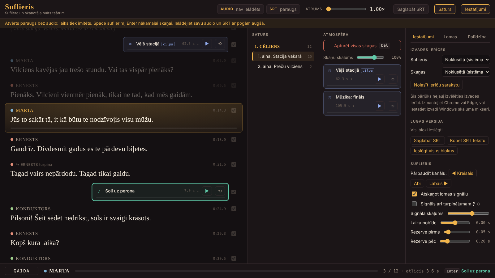

# Suflieris

**Suflieris ir audio sufliera un skaņotāja pults teātra kolektīvam.** Programma darbojas pārlūkā uz viena datora. Aktieriem tā pēc sufliera komandas atskaņo nākamo repliku austiņās, bet zālē atskaņo skaņas efektus.

## Kā tas darbojas

- Visa luga ir divi faili: **viens audio fails** ar ierakstītu tekstu un skaņām un **viens SRT subtitru fails**, kurā iezīmēts, kur katra replika un skaņa sākas un beidzas.
- Suflieris seko izrādei un īstajā brīdī nospiež **Space**. Aktieris austiņā dzird īsu savas lomas signālu un pēc tā repliku.
- Skaņu pa Wi-Fi uz aktieru telefoniem pārraida [AudioRelay](https://audiorelay.net). Efekti un fons skan zāles skaļruņos atsevišķi.
- Programma ir viens fails `suflieris.html`. Tas nav jāinstalē, un tas darbojas bez interneta.

## Iespējas

- Aktuālā replika vienmēr ir ekrāna vidū, ar progresa joslu
- Ātrums no 1× līdz 3× bez balss toņa maiņas
- Katrai lomai automātisks tonālais signāls; to var mainīt
- Lomas sadalītas pa kreiso un labo austiņu (divas aktieru grupas)
- Suflēšanu var izslēgt atsevišķām lomām
- Skaņas efekti tekstā un fona skaņas atsevišķā stabiņā, tie skan zāles skaļruņos
- Saturs ar cēlieniem un ainām ātrai pārvietošanai
- Lugas saīsināšana: teksta blokus var izslēgt un saglabāt kā jaunu SRT versiju

## Sākt

1. **[Atvērt programmu pārlūkā] (https://saulpalampe.github.io/suflieris/suflieris.html)** vai lejupielādēt [`suflieris.html`](suflieris.html?raw=true) un atvērt to Chrome vai Edge.
2. Lejupielādēt paraugu: [audio `luga_paraugs.mp3`](paraugs/luga_paraugs.mp3?raw=true) un [subtitrus `luga_paraugs.srt`](paraugs/luga_paraugs.srt?raw=true).
3. Programmā ielādēt audio un SRT ar pogām augšā un spiest **Space**.

**Pirmo reizi?** Īsa pamācība, kā no ieraksta un lugas teksta ar AI palīdzību izveidot savus failus: **[SAGATAVOSANA.md](SAGATAVOSANA.md)** (ar gatavu uzdevumu AI modelim).

Pilna lietošanas pamācība: **[INSTRUKCIJA.md](INSTRUKCIJA.md)**. Tajā aprakstīta audio un SRT faila sagatavošana ar Subtitle Edit, programmas vadība un skaņas savienojumi ar AudioRelay.

## Licence un atsauce

Projekts ir atvērts brīvai lietošanai: to var lietot, kopēt, pārveidot un izplatīt, arī komerciāli ([MIT licence](LICENSE)).

**Lūgums atsaukties uz pirmavotu.** Ja izmantojat vai pārveidojat Suflieri, lūdzu, norādiet autoru un saiti uz šo repozitoriju, piemēram:

> Suflieris, autors Dzintars Briedis, https://github.com/saulpalampe/suflieris
